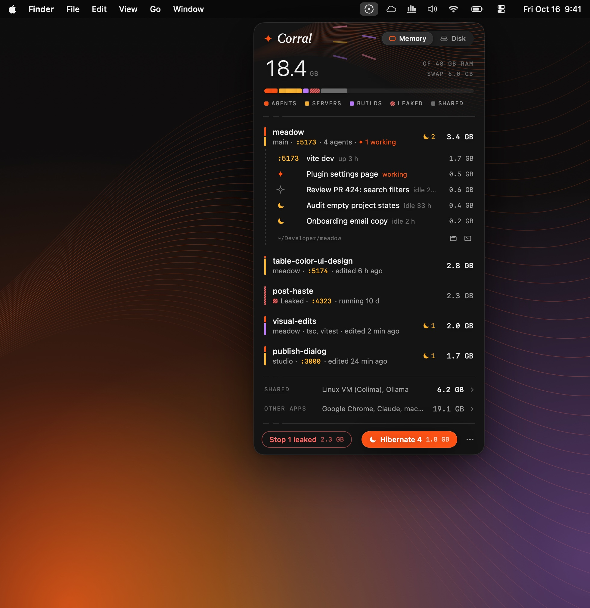

# Corral

**See which worktree is eating your memory or your disk, and put idle coding agents to sleep.**

Corral lives in your menu bar. It groups everything running on your Mac by git worktree, so agents, dev servers, build watchers and forgotten servers each show up where they belong, and you can free their memory in a click. Worktrees you're done with show how much disk they hold, and once everything in one is committed, it can go to the Trash in two clicks. Everything stays on your Mac.

**[Download Corral for macOS](https://github.com/khoinguyenpham04/corral/releases/latest)** · macOS 14 or later · Apple Silicon and Intel · Free and open source · Early preview



## Install

Paste this into Terminal. macOS won't stop Corral the first time it opens, because no browser downloaded it. It runs [scripts/install.sh](scripts/install.sh) from this repo, which checks the download against the release's SHA-256 fingerprint before installing anything.

```bash
curl -fsSL https://raw.githubusercontent.com/khoinguyenpham04/corral/main/scripts/install.sh | bash
```

Or download the `.dmg` from the [latest release](https://github.com/khoinguyenpham04/corral/releases/latest), drag **Corral** onto **Applications** and open it. Corral isn't notarized by Apple, so macOS stops it once: click **Done**, then **System Settings → Privacy & Security → Open Anyway**.

After that, Corral updates itself. When a new version is out, click **Install** in the panel.

## What it does

- **Memory by worktree.** One bar splits your memory into agents, dev servers, builds and shared services, with a piece for each worktree: hover a row and its pieces light up. Each row has the same split as a thin rail beside it. Click a row to see what runs inside.
- **Ports at a glance.** Every dev server shows the port it listens on, read from macOS rather than guessed from its command line. Click a port to open it in your browser.
- **Agents by name.** Sessions show their titles and whether they're working, idle or waiting for you. A ☾ marks worktrees with idle agents; click it to hibernate them.
- **Hibernate and Wake.** One click stops idle agents and frees their memory. Their sessions stay on disk, so Wake picks up where you left off.
- **Leaked servers.** Dev servers still running after their terminal or agent closed are marked Leaked, and one button stops them all.
- **Disk by idle worktree.** The Disk tab lists worktrees with nothing running in them, biggest first, by the space removing each frees once the Trash is emptied. Packages pnpm and bun share from their store barely count, so the numbers are often a quarter of what Finder shows; if anything, they're on the low side. When your disk is nearly full, the panel says so.
- **Safe by default.** Stopping takes two clicks. Corral never touches container VMs or sessions an app manages, never hibernates an agent mid-task, and keeps a log of everything it does.

Press **⌃⌥⌘M** to open it from anywhere, and **⌘1** or **⌘2** to switch between memory and disk. Right-click the icon for a quick Hibernate.

## Works with

| Tool | What Corral does |
| --- | --- |
| Claude Code, Codex, OpenCode, Pi, oh-my-pi | Titles and idle time; Hibernate, and Wake in the tab it ran in |
| Claude Desktop | Titles and idle time; Hibernate, and the session resumes on your next message |
| Codex Desktop, VS Code, Cursor, Devin Desktop, T3 Code | Shows their agents; the app keeps its own sessions |
| Devin CLI, Gemini, Cursor Agent, Amp, Copilot, Goose, Aider, Crush | Shows them, and stops them if you ask |
| Colima, Docker Desktop, OrbStack, Postgres, Redis and friends | Shows them as shared, with how to stop them |

People who don't use worktrees still see their biggest apps, under "Other apps".

## From the terminal

The welcome card, or **Settings → Command line**, adds `corral` to your terminal:

```text
corral                 worktrees, what runs in them, and their memory
corral agents --idle   agent sessions idle past the threshold
corral hibernate       stop idle agents (--dry-run to preview)
corral wake            resume the hibernated session for this directory
corral disk            idle worktrees, by the disk space each would free
corral log             everything Corral stopped, hibernated or woke
corral status          one line for prompts and tmux: "21.1 GB · ☾6"
```

## Safety and privacy

Corral is an early preview, built to be safe to leave running.

- **It looks; you decide.** Corral reads the list of running processes the way Activity Monitor does. Nothing it sees leaves your Mac, and it never asks for your password.
- **Nothing stops by accident.** Stopping takes two clicks and Hibernate has Undo. Corral never touches container VMs or sessions an app manages, never hibernates an agent mid-task, and logs everything it does under **Activity**.
- **Uncommitted work never goes to the Trash.** A worktree can go only when git says everything in it is committed and nothing is running in it; commits on no branch, a hibernated session, a lock or another checkout inside keep it where it is. Corral asks git again right before moving anything, and never deletes a commit or a branch. Files git ignores, like `.env`, go with the folder, as they would from Finder. Git's record of the worktree is kept until you empty the Trash, so Undo, or Put Back in Finder, brings it back where it was, on its branch when that's still free.
- **Want to just look first?** Turn on **Settings → Read-only**, and Corral can't stop or move anything.
- **Checked updates.** Once a day Corral asks GitHub whether a new version is out. It needs no account, that's its only network request, and you can turn it off. Every install and update is checked against its published SHA-256 fingerprint, and your current version stays in place until the new one is ready.
- **Easy to remove.** **Settings → Uninstall** moves Corral to the Trash and removes its settings, data, `corral` command and login item. Worktrees it moved to the Trash keep their git entries, locked, with a note saying how to bring them back.
- **Nothing hidden.** All the code is here, and [docs/DEVELOPING.md](docs/DEVELOPING.md) shows how to build Corral yourself.

Found a problem or have an idea? **⋯ → Send Feedback…** opens a [GitHub issue](https://github.com/khoinguyenpham04/corral/issues) with your versions filled in.

## Building and contributing

See [docs/DEVELOPING.md](docs/DEVELOPING.md).

## License

MIT. See [LICENSE](LICENSE).
